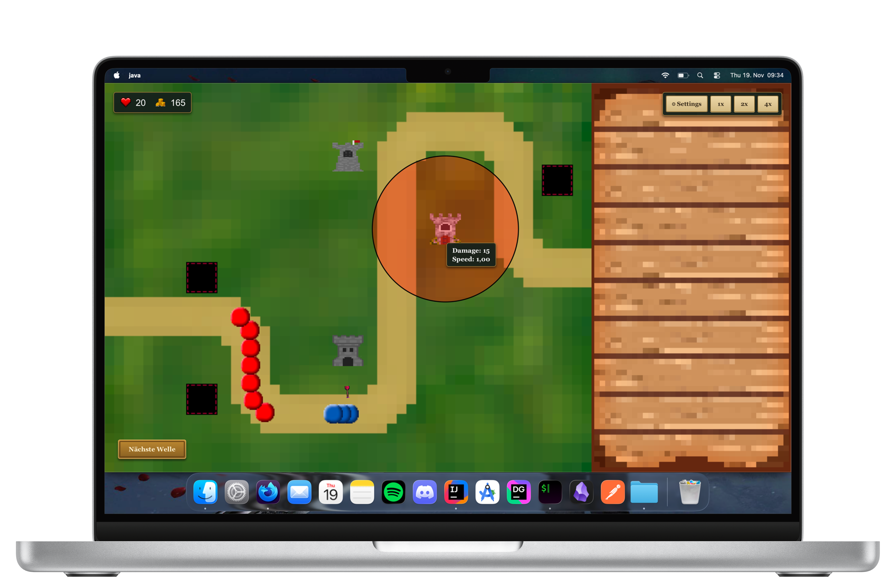

# Tower Defense

Tower Defense is a video game written in JavaFX. The game was mostly inspired by Bloons TD.
The goal of this game is to defeat all waves before they reach the right corner of the screen (the "base").

# 📸 Preview



# Features
- Enemy waves that go through a path
- Being able to place different kinds of towers
- Upgrade towers
- Creating one save state and loading the game
- Being able to win/lose
- Background music
- Pause the game with a settings menu

# Prerequisites
- JDK version 17 or higher
- Maven

# Installation

1. Clone the repository:
```zsh 
git clone https://github.com/s-karaa0/TowerDefense.git
```
2. Run the program either in your IDE (`Launcher.java`) or in your terminal with:
```zsh
mvn javafx:run
```

# Tech Stack
- JavaFX
- Java
- Gson

# :sunglasses: Authors
<ul>
<li><a href="https://github.com/s-karaa0">Sena Kara</a></li>
<li><a href="https://github.com/dlehner1">David Lehner</a></li>
<li><a href="https://github.com/Xier-BananenBrot">Julian Kreuzberger</a></li>
<li><a href="https://github.com/MaX116207">Maximilian Leimhofer</a></li>
<li><a href="https://github.com/Armin-Keric">Armin Keric</a></li>
<li><a href="https://github.com/samthurner">Samuel Thurner</a></li>
<li><a href="https://github.com/LorenzKreismayr">Lorenz Kreismayr</a></li>
<li><a href="https://github.com/Luhukas">Lukas Radlspöck</a></li>
</ul>